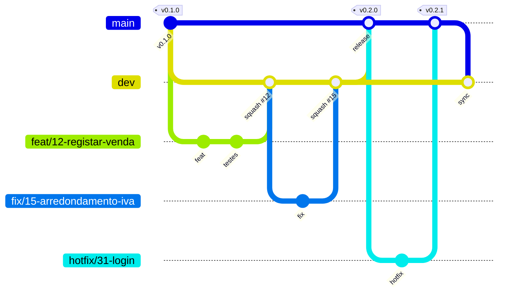

# Como contribuir

## Branches



| Branch | Criado a partir de | Entra em | Regras |
|---|---|---|---|
| `main` | — | — | Produção. Protegida. Só PRs de `dev` ou `hotfix/*`, com o E2E de staging a verde e a checklist de release preenchida. **Merge commit** (sem squash). Cada merge gera uma tag semver e um deploy. |
| `dev` | `main` | `main` | Integração. Protegida. Só PRs com o CI a verde. Cada merge faz deploy para staging. |
| `feat/*` · `fix/*` · `refactor/*` · `test/*` · `docs/*` · `ci/*` | `dev` | `dev` | Vida de 1 a 3 dias, um por issue. **Squash merge**; o branch é apagado depois. |
| `hotfix/*` | `main` | `main`, depois `dev` | Só para erros graves em produção. Depois do merge, a `main` é integrada na `dev`. |

Nome do branch: `<tipo>/<issue>-<descricao-curta>`, por exemplo `feat/12-registar-venda`.

Decisão registada no [ADR-0012](docs/adr/0012-estrategia-de-branches.md).

## Commits

[Conventional Commits](https://www.conventionalcommits.org/pt-br/v1.0.0/), com o módulo como âmbito:

```
feat(sales): regista venda com abate FEFO
fix(catalog): arredonda IVA por linha
docs(adr): acrescenta ADR-0013
ci: corre testes de integração com testcontainers
```

Tipos: `feat`, `fix`, `refactor`, `test`, `docs`, `ci`, `chore`, `perf`, `build`.

## Pull requests

1. Uma issue por tarefa; o PR fecha-a (`Closes #12`).
2. PRs pequenos: idealmente menos de 400 linhas alteradas.
3. O título do PR é a mensagem final do squash, em Conventional Commits.
4. Preenche o template, incluindo a parte de segurança.

## Checks automáticos

Correm em cada PR para a `dev` ou a `main`. A proteção dos branches exige dois checks agregadores: se um job falhar, o agregador falha e o merge fica bloqueado.

| Check obrigatório | Workflow | Inclui |
|---|---|---|
| `ci-ok` | `ci.yml` | `api-lint`, `api-generated`, `api-test` (unitários e integração, com `-race`), `api-build` (docker compose e smoke test), `pr-origin` |
| `security-ok` | `security.yml` | `gitleaks`, `govulncheck`, `codeql`, `trivy` |

- Os jobs da API só correm quando `api/`, `openapi/` ou o compose mudam. Um job saltado conta como sucesso.
- O `pr-origin` só corre em PRs para a `main` e recusa tudo o que não venha da `dev` ou de `hotfix/*`.
- O `security.yml` corre também todas as segundas-feiras, para apanhar vulnerabilidades novas em código que não mudou.
- O Dependabot propõe atualizações (Actions, Go e imagens Docker) para a `dev`, só com versões publicadas há pelo menos 14 dias.

Para correr o mesmo localmente: `make api-lint`, `make api-test` e `make api-test-integration`.

## Definição de pronto

### Para entrar na `dev`

- [ ] CI a verde: lint, testes unitários e de integração, build, E2E local
- [ ] Scans de segurança sem problemas críticos ou altos
- [ ] Código gerado atualizado
- [ ] Documentação e ADRs atualizados, se aplicável

### Para entrar na `main` (release)

- [ ] Tudo o que está acima
- [ ] E2E completo passou em staging com o mesmo commit
- [ ] Migrações correram em staging sem erros
- [ ] Teste manual do fluxo de venda em tablet
- [ ] [Checklist ASVS](docs/security/asvs-checklist.md) revista
- [ ] Changelog atualizado
