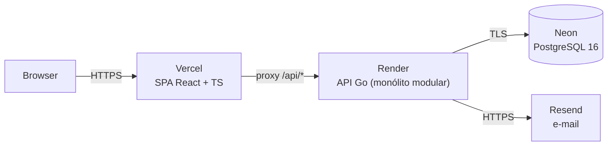

# Loja da Quinta

App web para gerir a loja de uma quinta que vende produtos agrícolas: catálogo, stock por lotes com validade, vendas ao balcão em tablet, relatórios e um catálogo público.

> **Estado:** arquitetura e documentação definidas; implementação a começar. Ver o [roadmap](#roadmap).

## O problema

Uma pequena quinta vende fruta, legumes, ovos, azeite e outros produtos na sua loja. O stock está em papel ou de memória, os produtos frescos estragam-se sem aviso e não há números sobre o que vende melhor. A Loja da Quinta resolve isto com:

- **Stock por lotes** com data de colheita e validade, e saída FEFO (o que expira primeiro sai primeiro).
- **Vendas ao balcão** rápidas em tablet, ao kg, ao litro, à unidade, ao molho ou à dúzia.
- **Alertas diários** de stock baixo e de produtos a expirar.
- **Relatórios** de vendas e produtos mais vendidos.
- **Catálogo público** com produtos da época e disponibilidade.

## Arquitetura



| Camada | Tecnologia |
|---|---|
| Frontend | React + TypeScript, Vite, React Router, TanStack Query, shadcn/ui, Tailwind |
| Backend | Go, `net/http`, arquitetura hexagonal, `pgx` + `sqlc`, `goose` |
| Contrato | OpenAPI 3.1, com código gerado para os dois lados (`oapi-codegen`, `orval`) |
| Base de dados | PostgreSQL 16 |
| Testes | `go test`, testcontainers, Vitest, Testing Library, MSW, Playwright, axe-core |
| CI/CD | GitHub Actions |
| Alojamento | Vercel, Render, Neon, Resend (tudo gratuito) |

## Documentação

| Área | Documentos |
|---|---|
| Requisitos | [Casos de uso](docs/requirements/use-cases.md) · [Funcionais](docs/requirements/functional.md) · [Não funcionais](docs/requirements/non-functional.md) |
| Arquitetura | [Visão geral (C4)](docs/architecture/overview.md) · [Backend](docs/architecture/backend.md) · [Frontend](docs/architecture/frontend.md) · [Modelo de dados](docs/architecture/data-model.md) |
| Decisões | [ADRs](docs/adr/README.md) |
| Segurança | [Controlos](docs/security/controls.md) · [Modelo de ameaças](docs/security/threat-model.md) · [Matriz de autorização](docs/security/authz-matrix.md) · [ASVS](docs/security/asvs-checklist.md) · [Política](SECURITY.md) |
| Processo | [Branches, commits e definição de pronto](CONTRIBUTING.md) |

## Decisões principais

- **Monólito modular em vez de microsserviços** ([ADR-0001](docs/adr/0001-monolito-modular.md)): a venda e o stock precisam da mesma transação, e menos serviços significam menos superfície de ataque.
- **OpenAPI primeiro** ([ADR-0003](docs/adr/0003-openapi-primeiro.md)): uma alteração ao contrato que parta o frontend ou o backend falha na compilação.
- **Autenticação própria** ([ADR-0005](docs/adr/0005-autenticacao-propria.md)): argon2id, JWT de 15 minutos em memória e refresh token rotativo com deteção de reutilização.
- **Mesma origem** ([ADR-0007](docs/adr/0007-mesma-origem-via-rewrite.md)): a Vercel encaminha `/api/*` para a API, sem CORS e com cookies `SameSite=Strict`.
- **Dinheiro em cêntimos** ([ADR-0009](docs/adr/0009-dinheiro-em-centimos.md)) e **stock por lotes com FEFO** ([ADR-0010](docs/adr/0010-stock-por-lotes-fefo.md)).

## Correr localmente

Requisitos: Docker. Para desenvolver a API, Go 1.26+; para o frontend (mais tarde), Node 24+.

```bash
cp .env.example .env            # muda as palavras-passe
docker compose up -d --build    # PostgreSQL 16, migrações e API
curl localhost:8080/api/v1/healthz
```

Comandos da API (testes, lint, geração de código): ver [api/README.md](api/README.md) ou `make help`.

Para usar o DBeaver: ligação PostgreSQL a `localhost:5432`, base de dados `loja`, utilizador `readonly` e a palavra-passe definida no `.env`.

## Estrutura

```
├── api/            backend Go
├── web/            frontend React + TS
├── openapi/        contrato da API
├── infra/          configuração de infraestrutura (PostgreSQL local)
├── docs/           requisitos, arquitetura, ADRs, segurança
└── .github/        CI/CD, templates, Dependabot
```

## Roadmap

- [x] Requisitos, arquitetura, ADRs e modelo de ameaças
- [x] Estrutura do repositório e PostgreSQL local
- [x] Spike: rewrite da Vercel contra o arranque a frio da Render (ADR-0007)
- [x] Esqueleto da API (health checks, middleware, configuração)
- [x] Pipeline de CI e análise de segurança
- [ ] Esqueleto do frontend e deploy em staging
- [ ] Autenticação e utilizadores (UC-01, UC-02)
- [ ] Produtos e categorias (UC-03), catálogo público (UC-10)
- [ ] Stock por lotes (UC-04, UC-05, UC-09)
- [ ] Vendas ao balcão (UC-06, UC-07)
- [ ] Relatórios e auditoria (UC-08, UC-11)
- [ ] v1.0.0 em produção
- [ ] v2: contas de cliente e encomendas para levantamento

## Licença

[MIT](LICENSE). Vulnerabilidades de segurança reportam-se em privado: ver [SECURITY.md](SECURITY.md).
