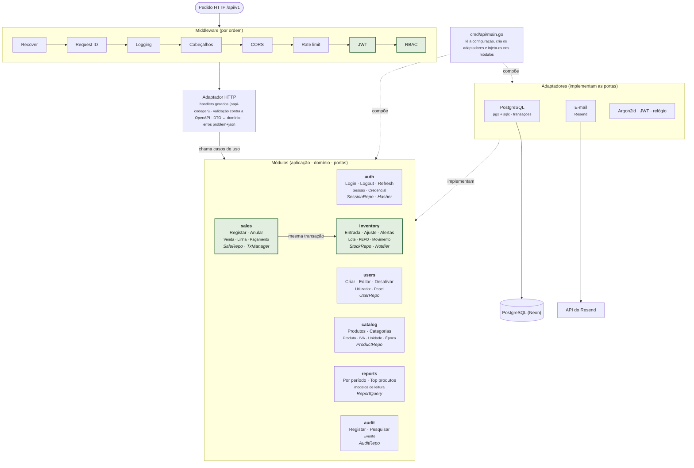

# Arquitetura do backend

**Monólito modular em Go com arquitetura hexagonal** ([ADR-0001](../adr/0001-monolito-modular.md)). Cada módulo tem as suas camadas e só expõe a interface do seu serviço. Um módulo nunca lê as tabelas de outro.

## Diagrama



As dependências apontam para dentro: o domínio não importa nada de HTTP nem de SQL. Os adaptadores implementam as portas, por isso os serviços testam-se com fakes em memória e os repositórios com PostgreSQL real (testcontainers).

`inventory` e `sales` estão em destaque porque partilham a transação da venda: `sales` chama o serviço de `inventory` dentro do mesmo `TxManager`. O job de alertas é uma goroutine agendada no mesmo processo e é o primeiro candidato a serviço separado (v2, com o outbox pattern).

## Organização de um módulo

```
internal/sales/
├── domain.go      entidades, value objects e regras (sem dependências externas)
├── service.go     casos de uso; recebe as portas por injeção
├── ports.go       interfaces que o módulo precisa (SaleRepo, TxManager…)
├── errors.go      erros de domínio tipados
├── postgres.go    adaptador PostgreSQL (usa o código gerado pelo sqlc)
├── http.go        handlers: traduz DTOs e erros
└── *_test.go      unitários (fakes) e de integração (testcontainers)
```

## Regras de dependência

- Um módulo só importa de outro módulo a **interface do seu serviço**, nunca o repositório nem os tipos internos.
- `domain.go` não importa `net/http`, `database/sql`, `pgx` nem outro módulo.
- Estas regras são verificadas no CI com `depguard` (golangci-lint).

## Convenções

- **Erros de domínio tipados** (`ErrInsufficientStock`, `ErrForbidden`…), traduzidos para HTTP só no adaptador.
- **Contexto em todas as chamadas**, com timeout por pedido e cancelamento propagado até à BD.
- **Idempotência** em `POST /sales` através da `Idempotency-Key`, guardada 24 h.
- **Concorrência no stock:** `SELECT … FOR UPDATE` nos lotes, ordenados por validade, dentro da transação.
- **Configuração por variáveis de ambiente**, validada no arranque: a API recusa arrancar se faltar um segredo.
- **Logs** com `log/slog` em JSON, sempre com `request_id`; nunca palavras-passe, tokens nem cookies.

## Stack

| Área | Escolha |
|---|---|
| Linguagem | Go 1.26 |
| HTTP | `net/http` (router nativo) |
| Contrato | OpenAPI 3.1 + `oapi-codegen` |
| Base de dados | `pgx` v5 + `sqlc` |
| Migrações | `goose` (SQL puro) |
| Logs | `log/slog` |
| Testes | `go test`, `testcontainers-go` |
| Lint | `golangci-lint` (incl. `gosec`, `depguard`) |
