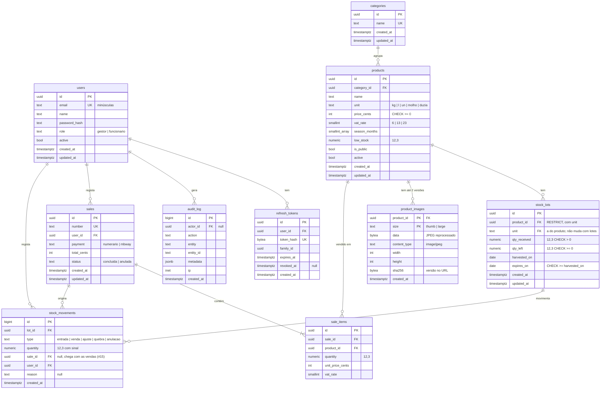

# Modelo de dados



## Decisões

- **Stock disponível** é a soma de `qty_left` dos lotes **dentro da validade** (`expires_on` a partir de hoje, na hora de Lisboa; um lote que expira hoje ainda conta). Um lote fora de validade não se pode vender, por isso não conta para o catálogo público nem, mais tarde, para as vendas. Cada alteração deixa um registo em `stock_movements`, que funciona como histórico completo ([ADR-0010](../adr/0010-stock-por-lotes-fefo.md)).
- **Uma entrada de stock é um lote e um movimento `entrada`, gravados na mesma transação**, com o utilizador que a registou (`POST /stock/lots`). A API recusa (422) quantidades que não são positivas, casas decimais em unidades, molhos e dúzias, produtos inexistentes ou desativados, colheitas no futuro e validades anteriores à colheita ou a hoje.
- **Ajustes e quebras por lote** (`POST /stock/adjustments`, só o gestor, RF-06): um `ajuste` corrige o lote para mais ou para menos, uma `quebra` tira stock que se estragou ou perdeu. O motivo é obrigatório (1 a 500 caracteres, uma linha) e fica no movimento, com quem o registou. Numa só transação, o lote é bloqueado (`SELECT … FOR UPDATE`), o serviço confirma que o que resta não fica negativo, `qty_left` é atualizado e o movimento é gravado. Dois pedidos ao mesmo lote ficam em fila: o segundo lê o que o primeiro deixou e, se já não houver que chegue, recebe `409` com o que resta. O `CHECK (qty_left >= 0)` é a última defesa. Este é o padrão de todas as saídas de stock: no `inventory`, `lockLot` + `applyMovement` (as vendas por FEFO do #15 bloqueiam os lotes do produto pela ordem da validade e aplicam o mesmo `applyMovement` a cada um). Um lote fora de validade ainda aceita quebras.
- **Leitura mínima dos lotes** (`GET /stock/lots?productId=`, funcionário e gestor): os lotes do produto com stock (também os fora de validade) ou ainda dentro da validade, por ordem FEFO, no máximo 200. É o que o ecrã de ajustes mostra; a consulta de todos os produtos é a de baixo.
- **Consulta do stock** (`GET /stock`, funcionário e gestor, RF-11): os produtos ativos (mesmo sem stock) e os desativados que ainda têm lotes com stock. Por produto, o stock vendável (lotes dentro da validade), `low` (produto ativo com o vendável **abaixo** do limiar; limiar 0 nunca dá) e os lotes com stock, cada um `valido`, `expira_em_breve` (validade de hoje a hoje + 3 dias) ou `fora_de_validade`. O `inventory` lê os seus lotes e pede os produtos ao catálogo; não há limite de lotes, para as somas estarem certas.
- **Alertas diários:** `stock_alert_runs` (`day date` como chave primária, `created_at`) guarda os dias de Lisboa em que o alerta saiu ([ADR-0015](../adr/0015-alertas-diarios-por-agendamento-externo.md)). Não se liga a mais nenhuma tabela.
- **A unidade de um produto com lotes não muda.** As quantidades dos lotes estão na unidade do produto: passar de kg para unidades leria 12,5 kg como 12,5 unidades. O catálogo recusa a mudança (`409`) perguntando ao `inventory` se o produto tem lotes (porta `catalog.LotChecker`). Como entre essa pergunta e a gravação pode entrar um lote, a garantia está na base de dados: cada lote guarda a unidade em que a quantidade foi validada, com uma chave estrangeira composta `(product_id, unit) → products (id, unit)` com `ON UPDATE RESTRICT` (migração 00005). Com `(id, unit)` numa chave única, mudar a unidade é uma atualização de chave e bloqueia a linha do produto com `FOR UPDATE`, que choca com o `FOR KEY SHARE` de quem insere um lote: quem chega em segundo espera pelo outro e é recusado (a mudança de unidade com `409`, ou o lote com `409` se a unidade mudou enquanto era registado). Editar o preço, o nome ou o resto do produto não toca na chave e não bloqueia as entradas de stock.
- **A quantidade de um movimento tem sinal:** entra no lote (`entrada`, `anulacao`) ou sai dele (`venda`, `quebra`); um `ajuste` pode ir para os dois lados. Um `CHECK` garante o sinal de cada tipo. A coluna `sale_id` chega com a tabela `sales` (#15), já com a chave estrangeira.
- **Movimentos só de acrescento:** um trigger recusa `UPDATE`, `DELETE` e `TRUNCATE` em `stock_movements` a toda a gente, incluindo o dono das tabelas, e o papel `app` só tem `INSERT` e `SELECT` (a migração tira-lhe o resto). Corrigir um engano é registar outro movimento.
- **Dinheiro em cêntimos inteiros** e quantidades em `numeric(12,3)` para pesos em kg e volumes em litros ([ADR-0009](../adr/0009-dinheiro-em-centimos.md)).
- **As linhas da venda guardam o preço e o IVA da altura**, para que mudar um preço não altere vendas antigas.
- **Datas em UTC** (`timestamptz`); a conversão para Europe/Lisbon é feita na apresentação.
- **`created_at` e `updated_at` nas tabelas que mudam** (`users`, `categories`, `products`, `stock_lots`, `sales`), ambos `timestamptz NOT NULL DEFAULT now()`. O `updated_at` é mantido por um trigger, para nunca depender de o código se lembrar de o atualizar:

  ```sql
  CREATE FUNCTION set_updated_at() RETURNS trigger LANGUAGE plpgsql AS $$
  BEGIN
    NEW.updated_at := now();
    RETURN NEW;
  END $$;

  CREATE TRIGGER products_set_updated_at
    BEFORE UPDATE ON products
    FOR EACH ROW EXECUTE FUNCTION set_updated_at();
  ```

- **Sem `updated_at` onde os registos nunca mudam:** `audit_log` e `stock_movements` são só de acrescento, e `sale_items` é gravado com a venda e não se altera. Um `updated_at` nestas tabelas daria a entender que podem ser editadas. `refresh_tokens` só tem `created_at`; a única alteração possível já fica em `revoked_at`.
- **O `updated_at` serve também de controlo de concorrência otimista:** a API devolve-o como `ETag` (em microssegundos, também no campo `version`) e exige `If-Match` ao editar um produto. Se dois gestores editarem o mesmo produto ao mesmo tempo, o segundo recebe `412 Precondition Failed` em vez de apagar as alterações do primeiro sem saber.
- **O `updated_at` diz quando, não quem nem o quê:** para isso existe a auditoria.
- **Imagens em `product_images`** ([ADR-0014](../adr/0014-imagens-dos-produtos-no-postgresql.md)): duas versões por produto (`thumb` 160 px, `large` 800 px), sempre reprocessadas em JPEG pela API. O `sha256` entra no URL, que é imutável e fica na cache da CDN. Trocar a imagem apaga e volta a inserir as duas linhas na mesma transação; por isso não há `updated_at`. `ON DELETE CASCADE` a partir de `products`.
- **Nomes únicos sem olhar a maiúsculas:** índices únicos em `lower(name)` nas categorias e nos produtos. "Fruta" e "fruta" seriam a mesma categoria, e dois produtos com o mesmo nome confundiriam a pesquisa no ecrã de venda.
- **Nada do catálogo se apaga com histórico:** `products.category_id` e `stock_lots.product_id` são `ON DELETE RESTRICT`, e as vendas vão apontar para os produtos da mesma forma. Apagar um produto com lotes dá `409`; o produto desativa-se. Os lotes também não se apagam: cada um tem pelo menos o movimento de entrada, que aponta para ele com `RESTRICT`.
- **E-mail guardado em minúsculas** (`CHECK (email = lower(email))`) em vez de `citext`: o papel `migrator` não pode instalar extensões na Neon, e a API normaliza o e-mail antes de o procurar.
- **Enums como `text` com `CHECK`**, em vez de tipos `ENUM` do PostgreSQL, para facilitar migrações.
- **Auditoria só de acrescento:** o papel `app` tem apenas `INSERT` e `SELECT` em `audit_log`.

## Papéis PostgreSQL

| Papel | Permissões | Usado por |
|---|---|---|
| `migrator` | DDL no schema da app | Workflow de deploy (goose) |
| `app` | DML nas tabelas da app; só `INSERT`/`SELECT` em `stock_movements` e `audit_log` | API |
| `readonly` | `SELECT` | DBeaver e diagnóstico |

Localmente, os papéis são criados por [`infra/postgres/init-roles.sh`](../../infra/postgres/init-roles.sh). As tabelas ficam no schema `loja`, cujo dono é o `migrator`.
