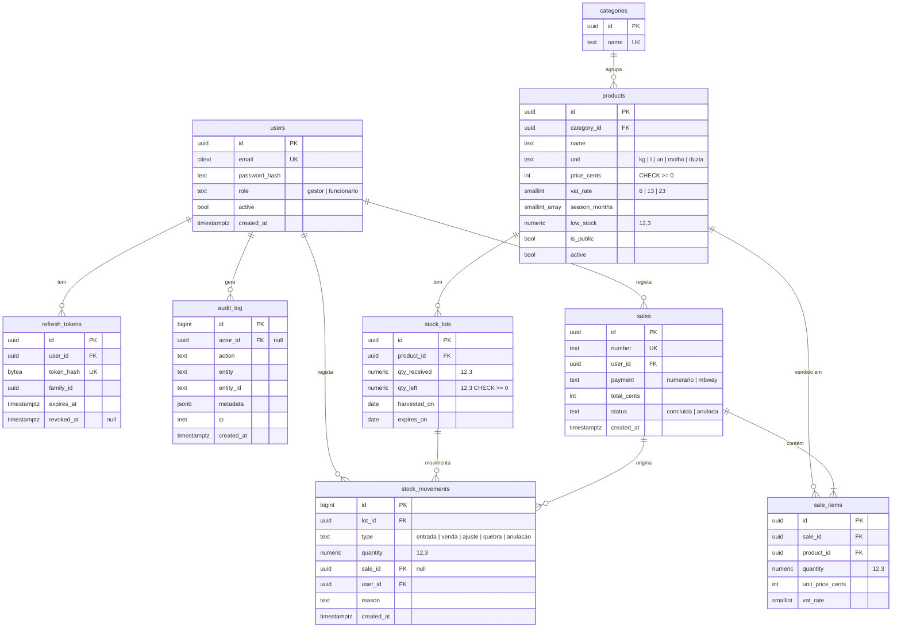

# Modelo de dados

## Decisões

- **Stock disponível** é a soma de `qty_left` dos lotes. Cada alteração deixa um registo em `stock_movements`, que funciona como histórico completo ([ADR-0010](../adr/0010-stock-por-lotes-fefo.md)).
- **Dinheiro em cêntimos inteiros** e quantidades em `numeric(12,3)` para pesos em kg e volumes em litros ([ADR-0009](../adr/0009-dinheiro-em-centimos.md)).
- **As linhas da venda guardam o preço e o IVA da altura**, para que mudar um preço não altere vendas antigas.
- **Datas em UTC** (`timestamptz`); a conversão para Europe/Lisbon é feita na apresentação.
- **Enums como `text` com `CHECK`**, em vez de tipos `ENUM` do PostgreSQL, para facilitar migrações.
- **Auditoria só de acrescento:** o papel `app` tem apenas `INSERT` e `SELECT` em `audit_log`.

## Papéis PostgreSQL

| Papel | Permissões | Usado por |
|---|---|---|
| `migrator` | DDL no schema da app | Workflow de deploy (goose) |
| `app` | DML nas tabelas da app; só `INSERT`/`SELECT` em `audit_log` | API |
| `readonly` | `SELECT` | DBeaver e diagnóstico |

Localmente, os papéis são criados por [`infra/postgres/init-roles.sh`](../../infra/postgres/init-roles.sh). As tabelas ficam no schema `loja`, cujo dono é o `migrator`.
