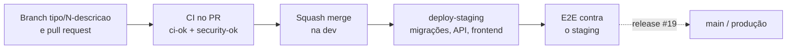

# Guia de DevOps

Como uma alteração chega do computador ao staging (e, a partir do #19, à produção): branches, pipelines, deploys, alojamento e segredos. É um guia de leitura; as regras curtas para quem programa estão no `CLAUDE.md` e no `CONTRIBUTING.md`.

## 1. O caminho de uma alteração

1. Cada issue tem um branch curto a partir da `dev` (`feat/15-venda-balcao`, `docs/16-…`) e um pull request para a `dev`.
2. O PR corre dois workflows: `ci.yml` e `security.yml`. Cada um termina num job **agregador** (`ci-ok` e `security-ok`).
3. A proteção da `dev` e da `main` só deixa fazer merge com os dois agregadores verdes **e** com o branch atualizado com a `dev`. Ninguém faz commit diretamente nestes branches.
4. O merge na `dev` é em *squash*: um commit por issue, com `Closes #N`.
5. O push na `dev` dispara o `deploy-staging.yml`, que publica e testa o staging.
6. Na release, a `dev` entra na `main` com um merge commit (ainda por fazer, #19).

`scripts/finish-issue.sh --pr <PR> --issue <N>` faz os passos 3 a 5 numa só ordem: atualiza o branch se estiver atrasado, espera pelos checks, faz o merge, espera pelo deploy, resume os E2E, fecha o issue e move o cartão para *Done*.

### Porquê agregadores

A proteção do branch pede nomes de checks fixos. Como o `ci.yml` salta jobs quando a pasta não mudou (ver abaixo), exigir cada job falharia nos PRs que não lhes tocam. O agregador passa quando todos os jobs passaram ou foram saltados de propósito, e só ele é obrigatório.

## 2. GitHub Actions

O **GitHub Actions** corre programas em máquinas descartáveis sempre que algo acontece no repositório: um PR, um push ou uma hora marcada. Cada **workflow** é um ficheiro em `.github/workflows/` e tem **jobs**, que correm em paralelo ou em sequência (`needs:`). As *actions* de terceiros estão fixadas pelo SHA do commit, não pela etiqueta, para que uma etiqueta movida não mude o que corre.

### `ci.yml`: integração contínua

Corre em cada PR, em cada push na `dev` e na `main`, e à mão (`workflow_dispatch`).

| Job | O que faz |
|---|---|
| `changes` | Vê que pastas mudaram (`api/`, `web/`, `openapi/`) para não correr os testes da API quando só mudou o frontend |
| `pr-origin` | Só em PRs para a `main`: só aceita os que vêm da `dev` |
| `api-lint` | `golangci-lint`: estilo e erros comuns, incluindo `gosec` (segurança) e `depguard` (o domínio não importa HTTP nem SQL) |
| `api-generated` | Volta a gerar o código a partir da OpenAPI (oapi-codegen) e do SQL (sqlc) e corre `go mod tidy`. Se houver diferenças, alguém se esqueceu de gerar e o PR falha |
| `api-test` | Unitários com `-race` (deteta acessos concorrentes perigosos), cobertura, e integração (`-tags=integration`) com PostgreSQL real num contentor. Inclui o teste de autorização gerado a partir da OpenAPI |
| `api-build` | Constrói a imagem Docker e arranca o `docker compose` completo (base de dados, migrações e API) para provar que sobe |
| `web` | `npm ci`, formatação, lint, tipos, Vitest, build e `npm audit --audit-level=high` |
| `ci-ok` | Agregador |

### `security.yml`: segurança

Corre em cada PR e push, e também todas as segundas-feiras às 06:00 UTC: aparecem vulnerabilidades novas em código que não mudou.

| Job | O que faz |
|---|---|
| `secrets` | **gitleaks**: procura segredos (chaves, palavras-passe) em todos os commits do PR, não só no último. Por isso um token de teste com ar de segredo falha mesmo depois de corrigido |
| `govulncheck` | Vulnerabilidades conhecidas nas bibliotecas Go **que o código chama de facto** |
| `codeql` | Análise estática do GitHub: injeção, caminhos de ficheiros, etc. Os resultados aparecem em *Security → Code scanning* |
| `trivy` | Analisa a imagem Docker: pacotes do sistema e dependências |
| `security-ok` | Agregador |

O `.gitleaks.toml` só tem uma exceção: o ficheiro gerado `openapi.gen.go`, que leva a especificação em base64 e parece um segredo.

### `deploy-staging.yml`: entrega contínua para staging

Corre em cada push na `dev`. Nunca correm dois ao mesmo tempo (`concurrency`): o mais recente espera. A ordem dos passos é o que importa:

1. **Migrações primeiro**, na Neon, com o papel `migrator`, o único que pode alterar tabelas. Se a API nova arrancasse antes, encontraria tabelas antigas.
2. **Contas E2E**: `createuser -if-missing` cria as contas de teste só se ainda não existirem. As palavras-passe vêm dos segredos do GitHub por variável de ambiente, nunca da linha de comandos.
3. **Deploy da API**: um `POST` ao *deploy hook* da Render, um URL secreto que manda reconstruir o serviço. O *Auto-Deploy* da Render está desligado precisamente para garantir o passo 1 antes deste.
4. **Esperar pela versão nova da API**: `/api/v1/healthz` devolve o commit que está a correr. O workflow repete o pedido até ser o commit do merge (até 15 minutos; a Render demora a construir e a API pode estar a dormir).
5. **`/readyz`**: confirma que a API chega à base de dados.
6. **Esperar pelo frontend**: a Vercel publica a `dev` sozinha a cada push; o workflow lê a `<meta name="app-version">` da página até ser o mesmo commit.
7. **E2E** (job `e2e`, depois de `deploy`): Playwright contra `https://loja-da-quinta-staging.vercel.app` em três tamanhos de ecrã, com o axe em claro e escuro.

**Porquê esperar pela versão.** Sem isto, os E2E podiam correr contra a versão anterior, que ainda está no ar enquanto a nova se constrói, e passar ou falhar pelas razões erradas.

**Porquê só capturas de ecrã.** O repositório é público e qualquer pessoa descarrega os artefactos. Os *traces* e relatórios HTML do Playwright guardam os pedidos, com palavras-passe e tokens das contas de teste. Por isso só se guardam PNG, só quando falha, durante 7 dias.

### `stock-alerts.yml`: tarefa agendada

Às 06:00 e às 07:00 UTC (07:00 em Lisboa, no inverno e no verão) corre `scripts/stock-alerts.sh`, que chama `POST /api/v1/jobs/stock-alerts` com o cabeçalho `X-Job-Token`. A API envia no máximo um e-mail por dia de Lisboa (ADR-0015).

Porque não há uma tarefa dentro da API: a Render adormece a API ao fim de 15 minutos sem pedidos, e uma goroutine agendada nunca chegaria a correr. O pedido do workflow acorda-a.

O GitHub só corre agendamentos (e o botão *Run workflow*) a partir do branch principal, a `main`. **Isto só começa a funcionar com a release (#19).** Até lá, o script corre-se à mão.

### Dependabot

`.github/dependabot.yml` abre PRs semanais para atualizar dependências de Go, npm, Docker e Actions:

- só propõe versões publicadas há pelo menos **14 dias** (*cooldown*), a mesma regra do projeto: dá tempo para se descobrir uma versão comprometida;
- agrupa atualizações relacionadas num só PR;
- aponta sempre para a `dev`, e os PRs passam pelo mesmo CI.

Atualizações que têm de andar juntas (por exemplo, o `init` e o `analyze` do CodeQL) às vezes chegam em PRs separados e falham; junta-se tudo num só PR.

## 3. Ambientes

| | Local | Staging | Produção (#19) |
|---|---|---|---|
| Branch | o teu | `dev` | `main` |
| Frontend | Vite em `localhost:5173` | Vercel (`loja-da-quinta-staging.vercel.app`) | Vercel, projeto próprio |
| API | `docker compose` | Render (`loja-da-quinta-api-staging`) | Render, serviço próprio |
| Base de dados | PostgreSQL no `docker compose` | Neon, branch `staging` | Neon, branch `main` |
| Deploy | à mão | automático em cada merge na `dev` | release `dev` → `main` |

## 4. Alojamento

| Peça | Serviço (gratuito) | Papel |
|---|---|---|
| Frontend | **Vercel** | Serve a SPA por CDN e é a porta de entrada: tudo o que começa por `/api/` é reencaminhado para a Render (*rewrite*, ADR-0007). O browser só vê uma origem: não há CORS e o cookie de sessão pode ser `SameSite=Strict`. Também põe os cabeçalhos de segurança das páginas |
| API | **Render** (Free) | Corre a imagem Docker da API. Adormece ao fim de 15 minutos sem uso; o primeiro pedido depois disso demora cerca de 12 segundos (*cold start*) |
| Base de dados | **Neon** | PostgreSQL gerido. Os *branches* da Neon são cópias isoladas da base de dados: staging e produção nunca partilham dados |
| E-mail | **Resend** | Ainda sem conta; até lá os alertas ficam no log da API |

Não há um API Gateway dedicado: as funções de um gateway estão divididas entre o *rewrite* da Vercel e os middlewares da API (ADR-0016).

### Papéis da base de dados

Cada um tem só o que precisa (`infra/`):

- `migrator`: altera tabelas; só o usa o passo de migrações;
- `app`: a API; lê e escreve dados, mas não altera tabelas, e em `stock_movements` só pode inserir e ler (os movimentos nunca se apagam);
- `readonly`: para consultar (DBeaver).

## 5. Segredos

Nunca estão no código, nos logs nem nos artefactos. Depois de gravados, ninguém os consegue ler; só os workflows ou o serviço os usam.

| Onde | Quais |
|---|---|
| GitHub → *Settings → Secrets and variables → Actions* | `STAGING_MIGRATIONS_DATABASE_URL`, `STAGING_DATABASE_URL`, `RENDER_STAGING_DEPLOY_HOOK`, `E2E_GESTOR_PASSWORD`, `E2E_FUNCIONARIO_PASSWORD`, `STAGING_JOBS_TOKEN` |
| Render → serviço → *Environment* | `APP_ENV`, `DATABASE_URL`, `TRUSTED_PROXY_HOPS`, `JWT_SIGNING_KEY`, `JOBS_TOKEN` (igual ao `STAGING_JOBS_TOKEN`); opcionais `RESEND_API_KEY`, `ALERTS_TO`, `ALERTS_FROM` |
| Local | `.env` (fora do Git) ou os valores de desenvolvimento por omissão |

Gera-se com `openssl rand` ou `go run ./cmd/jwtkey` e envia-se por *pipe* (`| gh secret set NOME`), ou para a área de transferência (`| clip.exe`) para colar num site, sem nunca aparecer no ecrã.

**Uma variável obrigatória nova tem de estar na Render antes do merge**: a API recusa arrancar sem ela e o deploy falha no passo 4.

## 6. Docker e ferramentas

| O quê | Para quê |
|---|---|
| `api/Dockerfile` | Compila em duas fases e copia só o binário para uma imagem *distroless*, sem shell e sem utilizador root |
| `docker-compose.yml` | O staging em miniatura: `db` (PostgreSQL), `migrate` (corre as migrações e sai) e `api` |
| `api/cmd/migrate` | Aplica as migrações (`api/migrations/`, goose) |
| `api/cmd/createuser` | Cria contas; a palavra-passe é pedida sem eco ou vem de uma variável de ambiente |
| `api/cmd/jwtkey` | Gera a chave Ed25519 que assina as sessões |
| `make dev-users` | Contas locais de teste |
| `scripts/finish-issue.sh` | Fecha um issue de ponta a ponta (secção 1) |
| `scripts/stock-alerts.sh` | Chama o job de alertas (usado pelo workflow ou à mão) |

## 7. O que falta para a produção (#19)

- Um segundo conjunto de serviços: projeto na Vercel, serviço na Render e branch `main` na Neon, com os seus papéis e segredos.
- Um workflow de deploy para a `main`, com os mesmos passos do staging.
- A primeira release: PR da `dev` para a `main` (merge commit) e etiqueta `v1.0.0`.
- Com a `main` publicada, o `stock-alerts.yml` passa a correr sozinho.

**Em resumo:** nada chega ao staging sem passar nos testes e nos scans de segurança, e nada chegará à produção sem ter passado primeiro no staging.
