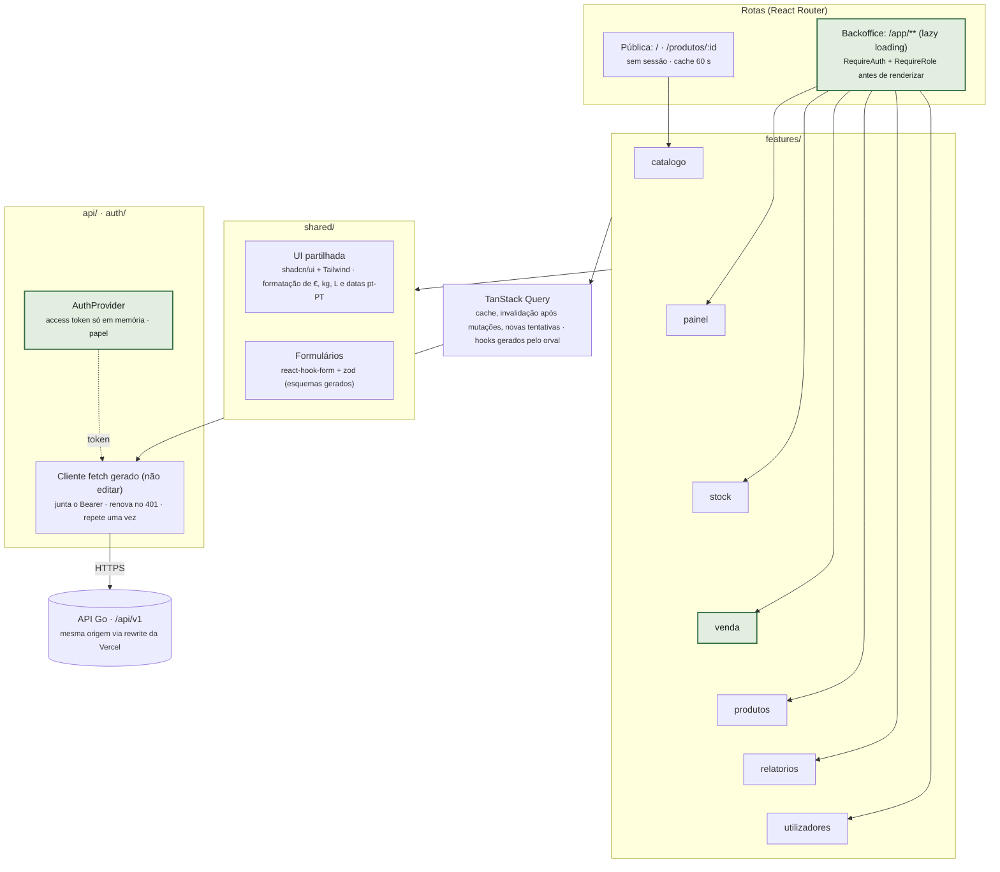

# Arquitetura do frontend

SPA em **React + TypeScript construída com Vite** ([ADR-0006](../adr/0006-spa-com-vite.md)), organizada por funcionalidade. O código que fala com a API é gerado a partir da mesma OpenAPI que o backend usa ([ADR-0003](../adr/0003-openapi-primeiro.md)).

## Diagrama



Cada funcionalidade tem as suas páginas, componentes e hooks; só a pasta `shared/` é partilhada. Os tipos, os hooks do TanStack Query e os esquemas zod são gerados pelo **orval** a partir da OpenAPI, por isso uma alteração ao contrato que parta o frontend falha no build.

As guardas de rota só melhoram a experiência: **a autorização real é sempre do servidor**.

## Estrutura

```
web/src/
├── app/            router, providers, layouts (público e backoffice)
├── features/
│   ├── catalogo/   páginas, componentes e hooks da funcionalidade
│   ├── painel/
│   ├── stock/
│   ├── venda/
│   ├── produtos/
│   ├── relatorios/
│   └── utilizadores/
├── shared/
│   ├── ui/         componentes shadcn/ui
│   ├── lib/        formatação (€, kg, L, datas), utilitários
│   └── hooks/
└── api/            gerado pelo orval (não editar à mão)
```

## Convenções

- **O estado do servidor fica no TanStack Query** e o estado de UI fica local (carrinho da venda com `useReducer`). Sem Redux.
- **Ecrã de venda pensado para tablet:** alvos de toque de pelo menos 44 px, teclado numérico e pesquisa com debounce.
- **Estado de arranque a frio:** se a API demorar mais de 3 s, aparece “a acordar o servidor”.
- **`dangerouslySetInnerHTML` proibido** por regra de ESLint.
- **Testes:** Vitest + Testing Library nos componentes, MSW para simular a API, Playwright + axe-core nos fluxos E2E.

## Stack

| Área | Escolha |
|---|---|
| Build | Vite |
| UI | React + TypeScript (strict) |
| Rotas | React Router |
| Estado do servidor | TanStack Query |
| Formulários | react-hook-form + zod |
| Componentes | shadcn/ui + Tailwind CSS |
| Cliente da API | orval (gerado da OpenAPI) |
| Testes | Vitest, Testing Library, MSW, Playwright, axe-core |
