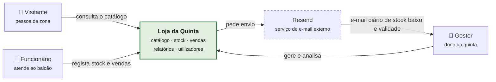
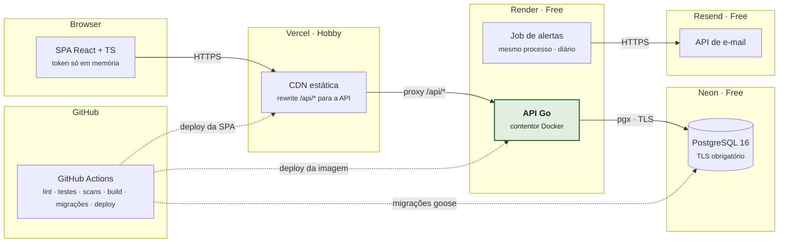

# Visão geral da arquitetura

A arquitetura segue o modelo [C4](https://c4model.com/). Os níveis 1 e 2 estão aqui; o nível 3 está em [backend.md](backend.md) e [frontend.md](frontend.md).

## C4 nível 1: contexto

O MVP só depende de um sistema externo: o envio de e-mail. Não há pagamentos nem integração fiscal, o que reduz a superfície de ataque.

## C4 nível 2: contentores e alojamento

O browser só fala com a Vercel. O rewrite de `/api/*` põe a API na **mesma origem** ([ADR-0007](../adr/0007-mesma-origem-via-rewrite.md)): não é preciso CORS e o cookie `SameSite=Strict` funciona.

> **Risco a validar logo no início:** confirmar que o tempo limite do proxy da Vercel aguenta o arranque a frio da Render. Se não aguentar, a alternativa é um domínio próprio partilhado pelos dois serviços.

## Ambientes

| Ambiente | Origem | Frontend | API | Base de dados |
|---|---|---|---|---|
| Local | máquina do programador | Vite dev server | `go run` ou Docker | PostgreSQL no `docker compose` |
| Staging | branch `dev` | deploy do branch `dev` na Vercel | serviço gratuito na Render | branch `staging` da Neon |
| Produção | branch `main` | Vercel (produção) | serviço gratuito na Render | branch principal da Neon |
