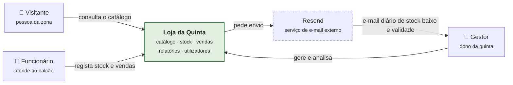
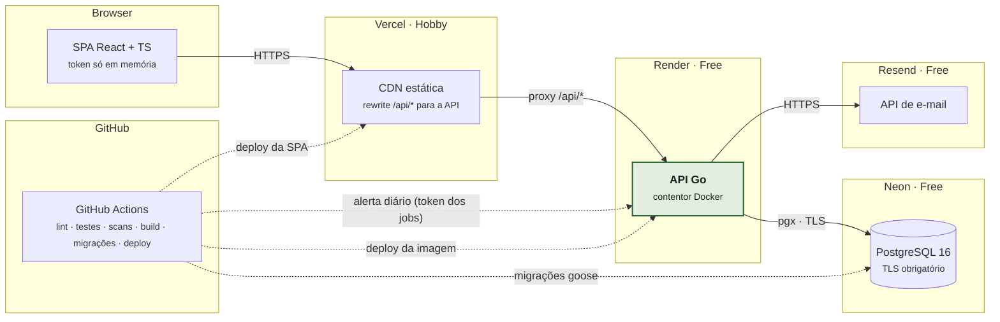

# Visão geral da arquitetura

A arquitetura segue o modelo [C4](https://c4model.com/). Os níveis 1 e 2 estão aqui; o nível 3 está em [backend.md](backend.md) e [frontend.md](frontend.md).

## C4 nível 1: contexto

O MVP só depende de um sistema externo: o envio de e-mail. Não há pagamentos nem integração fiscal, o que reduz a superfície de ataque.

## C4 nível 2: contentores e alojamento

O browser só fala com a Vercel. O rewrite de `/api/*` põe a API na **mesma origem** ([ADR-0007](../adr/0007-mesma-origem-via-rewrite.md)): não é preciso CORS e o cookie `SameSite=Strict` funciona.

> **Validado no spike #3:** o proxy da Vercel espera entre 91 e 120 s, e o arranque a frio medido na Render foi de 12,5 s. Ver [ADR-0007](../adr/0007-mesma-origem-via-rewrite.md).

## Ambientes

| Ambiente | Origem | Frontend | API | Base de dados |
|---|---|---|---|---|
| Local | máquina do programador | Vite dev server | `go run` ou Docker | PostgreSQL no `docker compose` |
| Staging | branch `dev` | projeto `loja-da-quinta-staging` na Vercel | `loja-da-quinta-api-staging` na Render (Frankfurt) | branch `staging` da Neon (Frankfurt) |
| Produção | branch `main` | Vercel (produção) | serviço gratuito na Render | branch principal da Neon |

### Staging

Endereço: <https://loja-da-quinta-staging.vercel.app>. Cada merge na `dev` publica-se sozinho, pelo workflow `deploy-staging.yml`:

1. **Migrações** na Neon com o papel `migrator`, antes de qualquer código novo chegar à API.
2. **Deploy da API** na Render, pedido pelo Deploy Hook. O Auto-Deploy está desligado para a API nunca arrancar antes das migrações.
3. **Espera pela versão**: o workflow só avança quando o `/api/v1/healthz` e a `<meta name="app-version">` do frontend mostram o commit acabado de entrar. A Vercel publica a `dev` sozinha.
4. **E2E** com Playwright contra o staging publicado: testes de fumo, acessibilidade WCAG 2.1 AA em modo claro e escuro, cabeçalhos de segurança da Vercel e a versão publicada. Correm em desktop, tablet e telemóvel.

Como chega à API certa: o `vercel.json` tem uma regra só para o domínio de staging (`has: host`), que encaminha `/api/*` para a API de staging. Qualquer outro domínio vai para a de produção.

Papéis na base de dados ([infra/neon/init-roles.sql](../../infra/neon/init-roles.sql)):

| Papel | Quem o usa | Pode |
|---|---|---|
| `migrator` | o workflow, nas migrações | DDL no schema `loja` |
| `app` | a API na Render | só DML (`SELECT`, `INSERT`, `UPDATE`, `DELETE`) |
| `readonly` | o DBeaver | só `SELECT` |

Segredos no GitHub: `STAGING_MIGRATIONS_DATABASE_URL` (papel `migrator`), `RENDER_STAGING_DEPLOY_HOOK`, as palavras-passe das contas E2E (`E2E_GESTOR_PASSWORD`, `E2E_FUNCIONARIO_PASSWORD`) e `STAGING_JOBS_TOKEN`. Na Render ficam o `DATABASE_URL` da API (papel `app`), o `JWT_SIGNING_KEY` e o `JOBS_TOKEN`; para os alertas saírem por e-mail, também `RESEND_API_KEY` e `ALERTS_TO` ([ADR-0015](../adr/0015-alertas-diarios-por-agendamento-externo.md)).

As contas `e2e-gestor@loja.test` e `e2e-funcionario@loja.test` são criadas pelo workflow com `createuser -if-missing`, logo depois das migrações. São só de teste: o domínio `.test` é reservado e nunca recebe e-mail.
