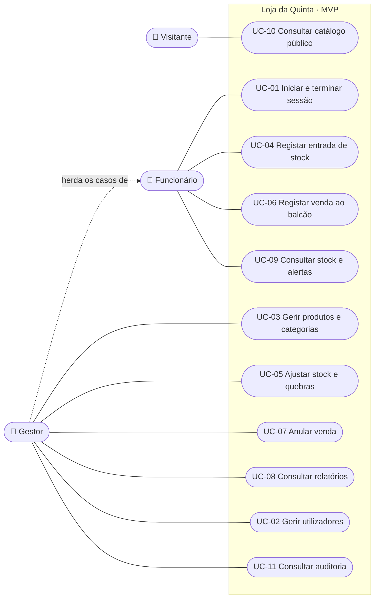

# Casos de uso

## Âmbito do MVP

O MVP cobre a gestão interna da loja e um **catálogo público**. Contas de cliente e encomendas ficam para a v2.

| Dentro do MVP | Fora do MVP |
|---|---|
| Backoffice com papéis **Gestor** e **Funcionário** | Contas de cliente e encomendas para levantamento (v2) |
| Produtos e categorias: preço por kg, litro, unidade, molho ou dúzia, IVA e época | Fotografias de produtos (v2) |
| Stock por lotes (colheita e validade) com saída FEFO | Pagamentos online (v3) |
| Vendas ao balcão em tablet, com anulação pelo gestor | Faturação certificada pela AT (ver [ADR-0011](../adr/0011-venda-nao-e-documento-fiscal.md)) |
| Relatórios e alertas diários de stock baixo e validade | Várias lojas, app nativa, integração com balanças |
| Catálogo público sem login | |
| Registo de auditoria de todas as alterações | |

## Glossário

| Termo | Significado |
|---|---|
| **Lote** | Entrada de stock de um produto, com quantidade, data de colheita e validade. |
| **FEFO** | *First Expired, First Out*: cada venda consome primeiro os lotes que expiram mais cedo. |
| **Quebra** | Saída de stock sem venda (estragado, oferta, erro de contagem). Exige motivo. |
| **Época** | Meses do ano em que o produto costuma estar disponível. |
| **Stock baixo** | Quantidade disponível abaixo do limiar definido no produto. |

## Atores

| Ator | Descrição |
|---|---|
| **Visitante** | Qualquer pessoa, sem sessão. Só consulta o catálogo público. |
| **Funcionário** | Atende ao balcão: regista entradas de stock e vendas. |
| **Gestor** | Dono da quinta. Pode fazer tudo o que o Funcionário faz e também gere preços, utilizadores, anulações e relatórios. |
| **Cliente** *(v2)* | Pessoa com conta que faz encomendas. |

## Diagrama

## Lista de casos de uso

| ID | Caso de uso | Ator principal | Versão |
|---|---|---|---|
| UC-01 | Iniciar e terminar sessão | Funcionário, Gestor | MVP |
| UC-02 | Gerir utilizadores e papéis | Gestor | MVP |
| UC-03 | Gerir produtos e categorias | Gestor | MVP |
| UC-04 | Registar entrada de stock (lote) | Funcionário | MVP |
| UC-05 | Ajustar stock e registar quebras | Gestor | MVP |
| UC-06 | Registar venda ao balcão | Funcionário | MVP |
| UC-07 | Anular venda | Gestor | MVP |
| UC-08 | Consultar relatórios de vendas | Gestor | MVP |
| UC-09 | Consultar stock e receber alertas | Funcionário, Gestor | MVP |
| UC-10 | Consultar catálogo público | Visitante | MVP |
| UC-11 | Consultar registo de auditoria | Gestor | MVP |
| UC-12 | Criar conta de cliente | Cliente | v2 |
| UC-13 | Encomendar para levantamento | Cliente | v2 |
| UC-14 | Preparar e entregar encomendas | Funcionário | v2 |

## UC-06 · Registar venda ao balcão

**Ator:** Funcionário
**Pré-condições:** o funcionário tem sessão iniciada; existem produtos ativos com stock.
**Pós-condições:** a venda fica gravada com estado `concluida`, o stock é abatido nos lotes por FEFO e fica um evento na auditoria.

### Fluxo principal

1. O funcionário abre o ecrã de venda.
2. Pesquisa um produto pelo nome e indica a quantidade: peso em kg ou volume em litros (até 3 casas decimais), ou número de unidades.
3. O sistema mostra o preço da linha e atualiza o total.
4. Repete os passos 2 e 3 para cada produto.
5. Escolhe o método de pagamento: numerário ou MB Way.
6. Confirma a venda.
7. O servidor recalcula preços e IVA a partir do catálogo, verifica o stock, abate os lotes por FEFO e grava a venda, os movimentos e a auditoria numa única transação.
8. O sistema mostra o número da venda e o resumo.

### Fluxos alternativos

- **7a. Stock insuficiente:** nada é gravado; o sistema indica o produto e a quantidade disponível.
- **6a. Cancelar antes de confirmar:** o carrinho é descartado e nada é gravado.
- **7b. Sessão expirada:** o frontend renova o token sem perder o carrinho; se a renovação falhar, pede login e mantém o carrinho em memória.
- **7c. Duplo clique ou falha de rede:** o pedido leva uma `Idempotency-Key`, e o servidor nunca grava a mesma venda duas vezes.

### Regras de negócio

- O preço vem sempre do servidor; preços enviados pelo cliente são ignorados.
- Os valores são calculados em cêntimos inteiros, com arredondamento por linha.
- O registo de venda **não é um documento fiscal** ([ADR-0011](../adr/0011-venda-nao-e-documento-fiscal.md)).
