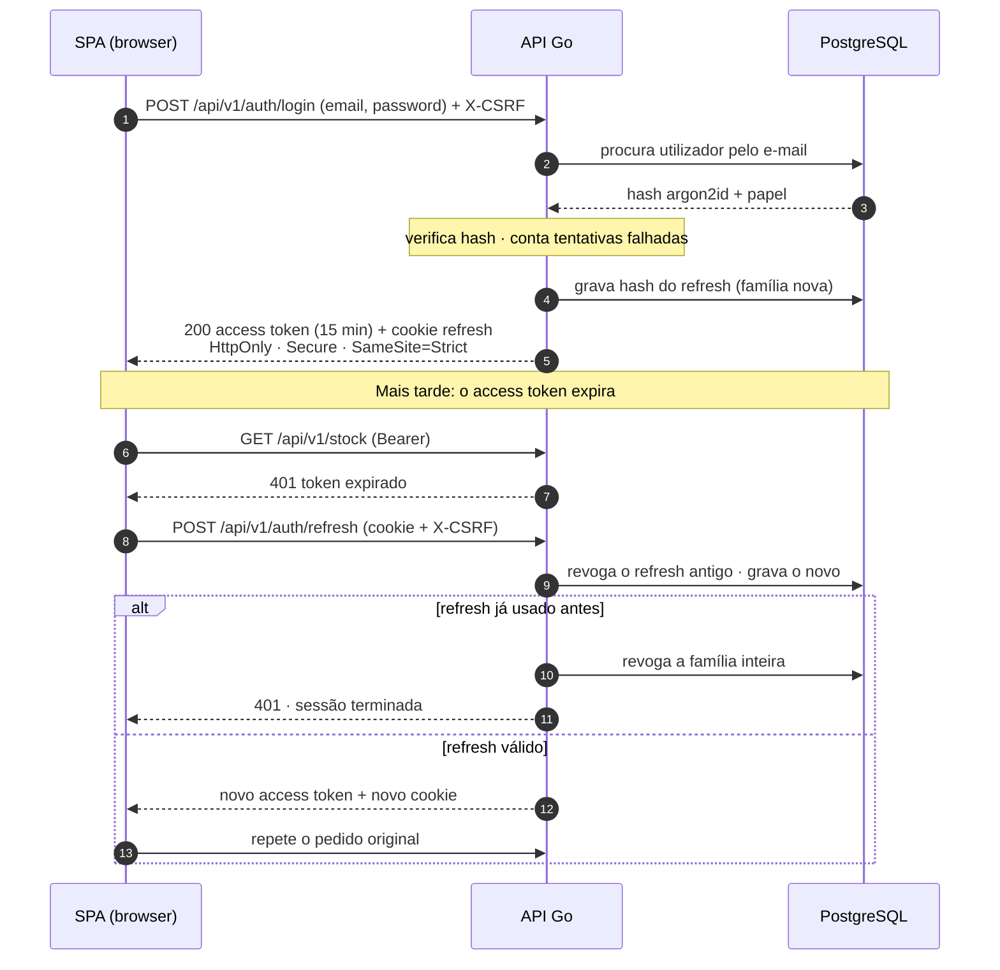

# Controlos de segurança

Defesa em profundidade: cada camada assume que a anterior pode falhar.

## Controlos por camada

| Camada | Controlos |
|---|---|
| **Borda** (`web/vercel.json`) | Só HTTPS, HSTS, CSP restritiva (`default-src 'self'`), `frame-ancestors 'none'`, `X-Content-Type-Options: nosniff` e `Referrer-Policy`. A API fica na mesma origem através de um rewrite ([ADR-0007](../adr/0007-mesma-origem-via-rewrite.md)). |
| **API** | Rate limiting por IP e, no login, por conta (5 tentativas falhadas em 15 min). Validação de todos os pedidos contra a OpenAPI, limite de tamanho do corpo, timeouts e erros `problem+json` sem detalhes internos. |
| **Autenticação** | argon2id, JWT de acesso Ed25519 com 15 min e `kid`, refresh opaco de 7 dias com rotação e deteção de reutilização ([ADR-0005](../adr/0005-autenticacao-propria.md)). |
| **Autorização** | RBAC com tudo negado por omissão: o middleware verifica o papel por rota e o serviço volta a verificar. A [matriz](authz-matrix.md) é testada automaticamente. Os jobs agendados têm um token próprio, que não dá acesso a mais nada ([ADR-0015](../adr/0015-alertas-diarios-por-agendamento-externo.md)). |
| **CSRF e XSS** | Mesma origem com `SameSite=Strict` e cabeçalho `X-CSRF` obrigatório no login, no refresh e no logout. O cookie só vai para `/api/v1/auth`. O React escapa o conteúdo; `dangerouslySetInnerHTML` está proibido por ESLint; CSP sem `unsafe-inline` nos scripts. |
| **Dados** | Queries parametrizadas (sqlc), TLS para a Neon, papéis PostgreSQL `migrator`, `app` e `readonly` ([modelo de dados](../architecture/data-model.md#papéis-postgresql)). |
| **Segredos** | Variáveis de ambiente na Render e na Vercel e GitHub Secrets. O `.env` é só local e está no `.gitignore`. gitleaks corre no CI. |
| **Cadeia de fornecimento** | Dependabot, CodeQL, gosec, govulncheck, npm audit e Trivy. Imagem distroless sem root. GitHub Actions fixadas por SHA, com `permissions` mínimas. |
| **Rastreabilidade** | Auditoria só de acrescento; logs sem palavras-passe, tokens nem cookies; request ID em todos os pedidos. |

## Fluxo de autenticação e renovação

O access token vive só em memória no browser, por isso um XSS não o encontra no `localStorage`. O refresh token nunca é acessível ao JavaScript. Se um refresh roubado for usado depois do legítimo, a reutilização é detetada e a família inteira de tokens é revogada.

Detalhes que fecham buracos conhecidos:

- **Pedidos em simultâneo:** a rotação bloqueia a linha do token (`SELECT … FOR UPDATE`), por isso dois pedidos com o mesmo refresh nunca rodam os dois. No browser, as renovações partilham o mesmo pedido e, entre separadores, esperam umas pelas outras (Web Locks), para um utilizador legítimo nunca ser confundido com um roubo.
- **Enumeração de contas:** e-mail desconhecido, palavra-passe errada e conta desativada dão a mesma mensagem e demoram o mesmo (um e-mail desconhecido também calcula um argon2id). O bloqueio por conta aplica-se a qualquer e-mail, exista ou não.
- **Só as falhas contam:** os limites do login contam tentativas falhadas. Quem acerta na palavra-passe nunca é travado por outra pessoa no mesmo IP (por exemplo, a rede da quinta).
- **Desativar termina as sessões:** desativar um utilizador, mudar-lhe o papel ou definir-lhe uma palavra-passe nova revoga todos os refresh tokens dele. O access token que já tem continua válido até expirar (no máximo 15 minutos), mas a renovação já não o deixa continuar. É o compromisso de um JWT curto sem consulta à base de dados em cada pedido.
- **Algoritmo fixo:** o access token só é aceite com `alg: EdDSA` e um `kid` conhecido, o que impede `alg: none` e a troca de algoritmo.
- **Memória:** no máximo 4 cálculos de argon2id em simultâneo (19 MiB cada), para um ataque não esgotar os 512 MiB da Render.

### Chaves dos access tokens

`JWT_SIGNING_KEY` tem o formato `kid:seed` e gera-se com `make jwt-key`. Para trocar de chave sem terminar sessões: a chave nova passa a `JWT_SIGNING_KEY`, a pública da antiga vai para `JWT_VERIFY_KEYS` e pode sair 15 minutos depois. Localmente, sem chave, a API usa uma temporária.

## Parâmetros

| Parâmetro | Valor |
|---|---|
| argon2id | m = 19 MiB, t = 2, p = 1 (mínimo OWASP) |
| Access token | 15 min, Ed25519, claims `sub`, `role`, `exp`, `iat`, `kid` |
| Refresh token | 32 bytes aleatórios, guardado como SHA-256, 7 dias |
| Rate limit login | 5 tentativas falhadas por conta em 15 min; 20 falhadas por IP por minuto (429) |
| Tamanho máximo do corpo | 1 MiB |
| Timeout por pedido | 10 s (30 s no upload de imagens, 25 s no job dos alertas) |
| Token dos jobs | pelo menos 32 caracteres (`openssl rand -hex 32`), em `JOBS_TOKEN` |
